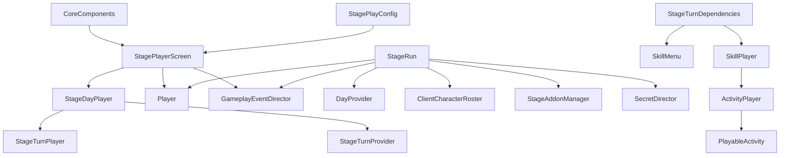

# Arquitetura — investigação estática, etapas 1 e 2

## Atualização de status — fase 3

A fase 3 resolveu o filtro diário por nível, a seleção obrigatória do tutorial, uma visita direta por evento e uma amostra da composição visual. Os vídeos foram decodificados localmente. Resultados em 16–19; especificação autoral em docs/DESIGN/GAMEPLAY_SPEC.md. Esta arquitetura histórica não é a arquitetura normativa do novo jogo.

## Registro anterior preservado

Data: 23/10/2026. Direção vigente: implementação independente de Problematic Exercise; a linha de modding foi encerrada por decisão do usuário. Os relatórios anteriores são históricos. Nenhum jogo, loader, perfil PE_Tester ou teste A/B/C foi executado nesta etapa. Nenhum sistema do novo jogo foi implementado.

## Critério de evidência

- **CONFIRMED:** fato diretamente lido em metadados, dados serializados ou corpo nativo, com escopo indicado; não significa teste de execução.
- **STRONGLY INFERRED:** relação funcional apoiada por contratos tipados e outros dados consistentes.
- **INFERRED:** hipótese plausível, sem corpo de método ou rastreamento suficiente.
- **UNKNOWN:** informação não determinada.
- **ORIGINAL DESIGN DECISION:** proposta autoral, sem atribuição ao jogo original.

Uma assinatura confirmada não confirma a execução de seu método, sua ordem, seus efeitos ou sua fórmula. Nas tabelas, a classificação do comportamento é independente da existência dos tipos.

## Fontes e procedimento

As pastas Original, WorkingCopy, Experiments, Tools e Evidence estão disponíveis. Foram lidos os dois relatórios anteriores e reutilizados o inventário UnityPy e as 136 DLLs de interop. A leitura da etapa 1 usou:

| ID | Evidência local | Uso |
|---|---|---|
| E1 | [type_contracts.json](../../../ProblematicSubjects_Research/StaticPhase1/type_contracts.json) | Assinaturas, propriedades, herança de wrappers, enums e parâmetros da assembly ProblematicStudents.dll |
| E2 | [selected_configs.json](../../../ProblematicSubjects_Research/StaticPhase1/selected_configs.json) | 15 objetos selecionados nos três bundles de estágio, com arquivo serializado, PathID, externals e campos |
| E3 | [resolved_config_edges.json](../../../ProblematicSubjects_Research/StaticPhase1/resolved_config_edges.json) | Nove ligações locais resolvidas de StagePlayConfig a dias, score e diretor de eventos |
| E4 | [asset_inventory.json](../../../ProblematicSubjects_Research/Evidence/asset_inventory.json) | Inventário anterior de objetos; organização visual e localização das referências MonoScript |
| E5 | [input_hashes.json](../../../ProblematicSubjects_Research/StaticPhase1/input_hashes.json) | SHA-256 da assembly de interop e do inventário usados nesta leitura |

Foi escrito um leitor original com Mono.Cecil já disponível, compilado com Roslyn existente. Ele lê metadados PE; **não carrega tipos do jogo, não invoca métodos e não exporta corpos descompilados**. UnityPy apenas leu configurações selecionadas em memória na WorkingCopy. Não foram exportados diálogos, imagens, áudio ou cenas. Scripts e evidências técnicas ficam na pasta de pesquisa; no projeto autoral entram apenas os documentos.

E1 contém 980 registros de tipos do namespace `ProblematicSubjects`, não 980 sistemas. A classificação técnica dos wrappers dá 909 classes, 70 enums e um struct. Isso **não reconstrói a distribuição original entre classes, structs e interfaces**: tipos com nomes como IStageTurn aparecem como wrappers de referência. Classes auxiliares aninhadas e métodos de máquinas assíncronas não foram inventariados em profundidade; foram recuperados os enums aninhados disponíveis, incluindo o Step do turno padrão.

## Atualização nativa da etapa 2

Foram recuperadas as transições reais do turno e a sequência padrão da visita, separação de seleção/arraste/confirmação, compra/descarte, fórmula de nota e tabela de pontos. Encerramento diário, aplicação de progresso e escolha do final também foram rastreados. Fontes N1–N9 e limitações estão no documento 13; detalhes nos documentos 03, 11 e 12. A etapa 1 abaixo continua sendo a fonte dos contratos e configurações; as relações operacionais agora usam a evidência nativa indicada.

## Mapa de responsabilidades

Todos os componentes da tabela existem em E1. A tabela foi revisada com a etapa 2: onde houver CONFIRMED operacional, o corpo correspondente está identificado em N4–N6/documento 13. Os demais itens continuam limitados a contratos ou dados.

| Sistema | Componentes centrais e dados | Relações sustentadas | Comportamento / limite |
|---|---|---|---|
| Composição e início | Core, CoreComponents, MainSystemsPrefabs | Core expõe Initialize, CreateCore, CreateSaveSystem e LoadSaveAndInitializeScene; CoreComponents reúne serviços tipados | **STRONGLY INFERRED:** composição central e inicialização relacionada ao save. Ordem exata do bootstrap **UNKNOWN** |
| Telas | GameScreenManager, ScreenTransitioner, BaseScreen, ScreenStartData | LoadSceneAsync recebe GameScreenId e LoadSceneMode; telas recebem CoreComponents | **STRONGLY INFERRED:** separação entre seleção de tela, transição e conteúdo. Grafo completo de cenas **UNKNOWN** |
| Menu e escolha de estágio | MainMenuScreen, MainMenuNavigation, StageSelectSection | Pilha de IMainMenuNavigable, NavigateTo/NavigateBack; seção produz ScreenStartData | **STRONGLY INFERRED:** navegação por seções e passagem de dados ao estágio. Mapeamento de cada botão **UNKNOWN** |
| Catálogo e progresso permanente | StageSystem, StageCoordinator, StageSerialized, StageSystemSerialized | Biblioteca de estágios, saveSystem, LoadAndCreateStage, CompleteStageAndSerializeIt | **STRONGLY INFERRED:** persistência de estágio distinta da sessão. Regras completas de desbloqueio **UNKNOWN** |
| Orquestração da sessão | StagePlayerScreen, StageRun, StageRunService | Tela contém dia, jogador, diretor, resultados, loja/upgrades; StageRun agrega seis dependências | **CONFIRMED** em LevelFlow: dias intermediários seguem para resultado/upgrades; último dia para resultado final. Bootstrap integral **UNKNOWN** |
| Dias e turnos | DayProvider, StageDayPlayer, StageTurnProvider, StageTurnPlayer, StandardStageTurn | DayProvider mantém dayIndex; provedor entrega IStageTurn; turno tem estados nomeados | **CONFIRMED:** transições, flag de etapa e loop normal recuperados; documentos 02, 11 e 12 |
| Elenco de clientes | ClientCharacterRoster, ClientCharacterRosterLogic, RosterData, ClientCharacterConfig | Configuração de quantidade por dia, escolha assíncrona, preferências por cliente e callbacks de UI | **CONFIRMED:** seleção por ID remove cliente dos disponíveis. Amostragem padrão **STRONGLY INFERRED**; filtros completos **UNKNOWN** |
| Visitantes/eventos | VisitingCharacterConfigLibrary, GameplayEventDirector, GameplayEventQueue | Biblioteca usa CharacterId; diretor possui filas por GameplayEventStage e players por tipo | **CONFIRMED:** estrutura distinta do roster. Não equiparar visitante a cliente escolhível |
| Escolhas e habilidades | SkillHand, SkillMenu, SkillMenuLogic, PlayerSkillManager, ActiveSkillDeck | Mão de ActiveSkill, conclusão assíncrona de escolha por int, descarte/recompra e overrides de lógica | **CONFIRMED:** mão padrão 3, clamp normal 0–5, descarte/reciclagem e cargas de reroll; sorteios completos **UNKNOWN** |
| Execução de atividade | SkillPlayer, ActivityPlayer, PlayableActivity, ActivityPrefabLibrary | SkillPlayer.PlaySkill recebe habilidade e cliente; ActivityPlayer recebe activityId, CharacterId[] e duração | **CONFIRMED:** PlaySkill passa ActivityId, personagens e duração à apresentação; score vem após atividade; resolução de todos os prefabs **UNKNOWN** |
| Diálogo | DialogueSystem, DialoguePlayStateMachine, PixelCrushersDialogueWrapper | Dependências de diálogo em cliente, habilidades, atividade e tela; modos manual/automático | **CONFIRMED:** diálogo de entrada precede escolha na visita padrão; saída é condicional. Condições integrais do banco **UNKNOWN** |
| Preferências e score | ClientCharacterScoreCalculator, ClientPreferencesResult, PlayerScore, PlayerScores | Calculate(cliente, habilidade) retorna PlayerScore; Player acumula scores e calcula resultados | **CONFIRMED:** agregação observada, nota e pontos recuperados; anomalia Likes/Dislikes documentada em 03 |
| Resultados e recursos | EndOfDayResult, DayProgressResult, EndOfRunResult, MedalObjectivesTracker, MedalWallet | Resultado diário contém scores/progresso/presentes; final contém endingId/medalhas | **CONFIRMED:** aplicação/clamp e predicado de final; soma diária **CONFIRMED**; medalhas e abertura de presentes **UNKNOWN** |
| Personagens e animação | ActivityPose, ActivityFaceSwappableCharacter, ActivityPoseFixedCharacter, MainCharacterAnimationsConfig | Bibliotecas, headTransform, renderers; grupos Idle, PayingAttention e coleções aleatórias | **CONFIRMED:** dependências de apresentação. Bindings completos, transições e escolha de expressões **UNKNOWN** nesta fase |
| Galeria | GalleryScreen, GalleryMainSection, GalleryActivitySection, GallerySkillPlayer | Tela referencia WorldStage, finais e dois níveis de seção | **STRONGLY INFERRED:** apresentação reutiliza componentes do estágio. Regras de acesso **UNKNOWN** |
| Loja e upgrades | MedalShopSection, TrinketSystem, UpgradeSection, GymLevelShop | Loja de medalhas usa carteira/itens; tela de sessão tem UpgradeSection; GymLevelShop é outro tipo | **CONFIRMED:** há estruturas distintas. Não tratar todas como uma única loja; custo/validação/efeitos **UNKNOWN** |
| Persistência | SaveSystem, GameSave, SavePersistenceAdapter, StandaloneDataPersistence, SavePorter | JObject, versionamento, LoadItem/SaveItem, adapter, armazenamento, export/import | **STRONGLY INFERRED:** save composto e migrável. Caminho, chave, encoding e gatilhos exatos **UNKNOWN** |

## Relações de configuração confirmadas

E2/E3 confirmam `StagePlayConfig → daysConfig`, `→ scoreConfig` e `→ gameplayEventDirectorConfig` nos três estágios, resolvendo FileID zero e PathID dentro do mesmo arquivo serializado. Não é correspondência apenas de nomes.

Outros campos de StagePlayConfig comprovam a existência de referências de cenário, apresentação de diálogo, biblioteca de atividades, áudio, preferências, tags, assets compartilhados, addons e segredos. Referências externas são preservadas em E2, mas não foram todas resolvidas recursivamente. PathIDs não são identificadores globais: a chave de identificação inclui bundle, arquivo serializado, FileID e PathID.

Exemplo rastreável: no bundle `9c1d36678f140b452c6721d68c96bb31.bundle`, o StagePlayConfig PathID `8946692029927174933` referencia o StageDaysConfig `2337878950216667693`, o score `-5069843982871259368` e o diretor `-1788232413758778425`. A configuração inline de atividades aponta para uma ActivityPrefabLibrary, coerente com o tipo declarado em E1.

## Dependências de sessão

Setas representam campos/contratos de dependência em E1, não uma sequência de chamadas confirmada. A construção integral permanece a rastrear; a criação de dependências de turno e os ciclos centrais receberam análise dirigida na etapa 2. CoreComponents é recebido na inicialização da tela; a configuração da tela é uma propriedade tipada.

## Persistência: distinção importante

**CONFIRMED (contrato):** StageRunSerialized contém dia, jogador, roster, diretor de eventos, addons e segredos. StageRunService distingue sessão ativa e limpeza da sessão. StageSystemSerialized é separado.

**STRONGLY INFERRED:** uma sessão em andamento possui representação persistível própria, além do progresso permanente do estágio. Isso altera o planejamento da implementação independente: “salvar só o dia e o dinheiro” não é equivalente ao contrato encontrado.

**UNKNOWN:** completude do snapshot, quando ocorre gravação e qual mecanismo guarda cada camada. Os PlayerPrefs observados na investigação histórica não demonstram que a campanha seja armazenada no registro. Esta etapa não leu saves pessoais.

## Consequências para implementação independente

**ORIGINAL DESIGN DECISION:** usar módulos próprios de catálogo, sessão, turnos, escolhas, apresentação, avaliação e persistência, com contratos estreitos. IDs, terminologia pública, conteúdo e parâmetros serão autorais. A estrutura acima orienta responsabilidades; não é autorização para copiar classes, código ou configurações para o jogo novo.

**CONFIRMED:** a etapa 2 recuperou regras suficientes para documentar pontuação e o ciclo padrão. Probabilidades completas, efeitos completos dos modificadores de stamina, recompensas e desbloqueios ainda têm lacunas. **ORIGINAL DESIGN DECISION:** escrever a especificação independente com decisões próprias, sem implementar nesta etapa.
