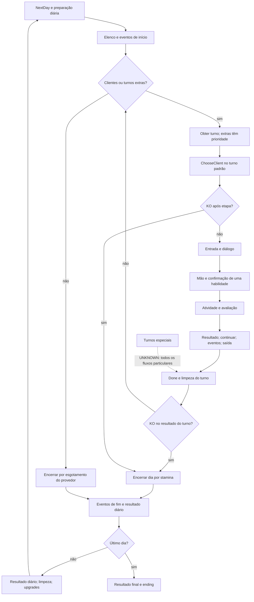

# Fluxo principal — reconstrução estática, etapas 1 e 2

## Atualização de status — fase 3

A correlação local dos cinco vídeos foi concluída por amostragem na fase 3 (18_REFERENCE_TIMELINE). O evento de habilidade especial pode chamar a visita diretamente, fora de StandardStageTurn (16_ROSTER_AND_EVENTS). O fluxo aqui continua válido para o caminho padrão.

## Registro anterior preservado

23/10/2026. Esta revisão substitui o fluxo apenas candidato da etapa 1 pelas relações nativas recuperadas. Nenhum jogo foi executado. Fontes E1–E5 no documento 01; N1–N9, índices e endereços no documento 13.

## Fluxo central recuperado

**CONFIRMED no caminho normal:** LevelFlow obtém Day, prepara sistemas diários e aguarda PlayDay. O dia configura o elenco, apresenta início e processa eventos. O provedor prioriza turnos extras; sem eles, cria turno padrão enquanto houver clientes.

**CONFIRMED:** no StandardStageTurn, a primeira chamada avança para seleção do cliente e a segunda para a visita. MainClientPhase delega a ClientVisitHelper. Não há uma terceira operação independente Prepare dentro de InternalPlayStep. Estado inicial zero de uma instância nova é **STRONGLY INFERRED**; incrementos e Done são **CONFIRMED**.

**CONFIRMED:** a visita aguarda entrada, diálogo e habilidade; inicia tarefas de transição junto com PlaySkill; depois processa eventos da habilidade e saída. O fluxo padrão possui uma escolha e uma execução, sem loop de nova escolha recuperado. A limpeza normal termina a visita e escreve Done no turno.

As setas contínuas resumem o caminho normal **CONFIRMED** em continuações e branches nativos. Detalhes de composição do bootstrap e comportamento de cada turno especial permanecem **UNKNOWN**. O desenho não afirma que toda extensão execute ChooseClient ou compartilhe a mesma visita.

## O que a sequência explica

| Questão | Resultado atual | Onde está detalhado |
|---|---|---|
| Turno e repetição | Incrementos reais e uma visita padrão por conclusão; sem repetição interna recuperada | Documento 11 |
| Escolha | Selecionar/prévia, arrastar e confirmar têm eventos distintos; confirmação resolve ID na mão | Documento 03 |
| Descarte | Todas as compras da mão vão ao descarte ao concluir a espera; reposição recicla | Documento 03 |
| Atividade e score | ID de atividade é obtido antes; score é calculado após a atividade e registrado antes de continuar | Documento 03 |
| Preferências | Correspondências por habilidade e tag; anomalia de Dislikes preservada | Documento 03 |
| Nota | Base de raridade e ajuste de preferência; tabela de pontos distinta do enum | Documento 03 |
| KO | Flag de etapa só pula teste intermediário; resultado final ainda testa KO | Documentos 11 e 12 |
| Dia/final | Provedor esgota por ausência de clientes e extras; último dia e progresso têm branches recuperados | Documento 12 |

**UNKNOWN:** recuperação completa em cancelamentos, mapa de visitantes/gatilhos, filtros específicos e sorteios exatos, medalhas, abertura de presentes e persistência completa. Não preencher essas lacunas com regras típicas do gênero.

**UNKNOWN por vídeo:** nenhuma seta foi confirmada por observação dos MP4 nesta entrega; a tentativa de abertura local foi bloqueada. Documento 14 registra a limitação, sem timestamps inventados.

**ORIGINAL DESIGN DECISION:** a implementação de academia poderá adotar um ciclo próprio com fases semelhantes e contratos separados, mas deve decidir seus próprios conteúdos, regras negativas, recursos e parâmetros. A etapa atual produziu documentação, não código de gameplay.
