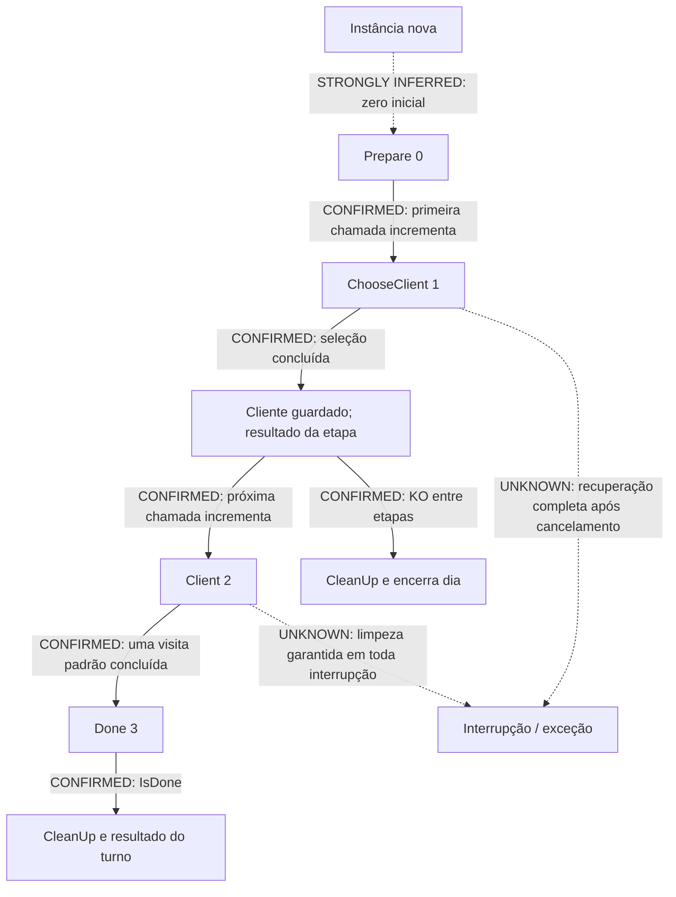

# Máquina de estados e sequência da visita

## Atualização de status — fase 3

A fase 3 confirmou uma exceção fora desse turno: SecretSkillGameplayEventPlayer chama MakeClientVisit com lógica de mão substituída. A flag de interrupção de espera é jumpsAndInterrupts, distinta de isImportant. Ver documento 16; não extrapolar a máquina padrão para todos os eventos.

## Registro anterior preservado

23/10/2026. Análise estática dos corpos nativos e das máquinas assíncronas. Todas as posições são RVAs. Identificadores e fontes no documento 13. Nenhum callback foi invocado e nenhuma navegação foi simulada.

## Estados efetivos do turno padrão

**CONFIRMED:** `StandardStageTurn.SetUp` (`18cf7c0`) recebe dependências e guarda roster, rastreador de fase e diretor de eventos; depois chama `OnSetup`. Não foi encontrada nessa função uma escrita explícita `currentStep=Prepare`. O valor inicial zero é compatível com uma instância nova; reutilização arbitrária de instâncias não foi demonstrada.

**CONFIRMED:** no caminho normal de `PlayNextStep.MoveNext` (`18d60b0`), a entrada incrementa `currentStep` **antes** de chamar `InternalPlayStep` (`18d61a5`). O incremento não se repete ao retomar o mesmo await. Ao concluir a etapa Client, escreve Done (`18d6161–18d6167`). `IsDone` compara o campo com 3 (`18cf570`).

| Estado anterior | Operação / condição | Resultado | Confiança |
|---|---|---|---|
| Prepare=0 em instância nova | Primeira chamada de PlayNextStep | Incrementa para ChooseClient=1 e executa a seleção | **CONFIRMED** no incremento; inicialização zero **STRONGLY INFERRED** |
| ChooseClient=1 | Seleção termina normalmente | Guarda cliente; retorna resultado da etapa e permanece em 1 | **CONFIRMED** |
| ChooseClient=1 | Próxima chamada de PlayNextStep | Incrementa para Client=2; executa MainClientPhase | **CONFIRMED** |
| Client=2 | Visita termina normalmente | Escreve Done=3 e devolve resultado | **CONFIRMED** |
| Done=3 | Orquestrador consulta IsDone | Encerra o loop do turno e chama CleanUp | **CONFIRMED** no caminho normal |
| Estado inesperado em InternalPlayStep | Não é 1 nem 2 | Caminho de ArgumentOutOfRangeException | **CONFIRMED** |

Prepare não foi encontrado como uma terceira atividade executada dentro de `InternalPlayStep`. É um marcador anterior à primeira etapa. Não chamar PlayNextStep depois de Done como se houvesse reinício automático.

As setas contínuas representam branches do caminho normal analisado. As pontilhadas delimitam inferência ou lacuna; não são transições de gameplay confirmadas.

## Seleção do cliente

**CONFIRMED:** `ChooseClient.MoveNext` (`18d08e0`) muda a fase para ChooseClientStart=5, cria um token vinculado, registra um callback relacionado ao diretor de eventos e espera `roster.ShowAndAWaitResponse`. Há verificação explícita do token externo após a espera e remoção do delegate/disposição do token no trecho de saída analisado. O caminho de sucesso muda para ChooseClientEnd=6 e WaitingForClient=1. A função contém branches adicionais de interrupção; não se afirma que todas as exceções restaurem o mesmo estado visual.

**CONFIRMED:** o roster obtém o conjunto da rodada pela lógica ativa, envia dados à UI e aguarda um ID. Depois procura um cliente correspondente entre os disponíveis, remove o escolhido da lista disponível e o resolve no dicionário por ID (`ShowAndAWaitResponse.MoveNext`, `18bd6e0`, especialmente `18bda2c–18bdb4f`). O uso de `First` com predicado delimita a seleção ao conjunto consultado; não foi encontrado um fallback universal para ID inválido.

**STRONGLY INFERRED:** a lógica padrão embaralha disponíveis e mostra até 2 ou 3 opções: há chamada `Random.Range(2,4)` e uma sequência compatível com embaralhar/Take/materializar (`18ab0f0`). Alguns destinos genéricos não têm nome inequívoco no cache; por isso o algoritmo completo de amostragem não é classificado como integralmente confirmado.

**CONFIRMED:** existem lógica base e override, e lógica específica de tutorial. **UNKNOWN:** todos os casos de cliente obrigatório e todas as condições que instalam overrides. Não generalizar a escolha aleatória padrão para tutoriais e eventos. Não foi encontrado neste turno um botão de “escolher outro” depois da seleção concluída.

## Uma visita padrão, em ordem operacional

**CONFIRMED:** `MainClientPhase.MoveNext` (`18d2d50`) delega uma vez a `ClientVisitHelper.MakeClientVisit`. O corpo operacional deste helper é `18d2fd0`:

1. Reúne sistemas das dependências, muda para ClientVisitStart=4 e ajusta o modo do WorldStage.
2. Aguarda a entrada do cliente no cenário.
3. Aguarda o diálogo de entrada do cliente.
4. Aguarda `SkillMenu.WaitForSkillChoice`; a lógica normal prepara e apresenta a mão durante essa espera.
5. Com a habilidade recebida, inicia em conjunto tarefas de modo de diálogo, fade de personagens e `SkillPlayer.PlaySkill`. O fade e a execução fazem parte de um `WhenAll`; não é correto afirmar que o fade inteiro sempre acaba antes de PlaySkill começar.
6. Aguarda eventos da fila SkillPlayEnded=1.
7. Prepara saída; aguarda em conjunto mudança de modo de diálogo, Hide do SkillPlayer, fade de entrada dos personagens e animação dos scores agregados.
8. Reseta SkillPlayer e modo de diálogo. Se ainda houver personagem visitante ativo no WorldStage, aguarda diálogo de saída do cliente.
9. Limpa overrides de habilidades, reseta WorldStage, chama `ClientCharacter.LevelUp` e muda para ClientVisitEnd=3.
10. Conclui a visita; PlayNextStep marca Done.

Pontos de apoio: `18d331b`, `18d335b`, `18d3456`, `18d3557`, `18d3768–18d37a9`, `18d389c`, `18d3996–18d3a55`, `18d3ada–18d3afc`, `18d3b65–18d3ba7`. A chamada LevelUp é confirmada; sua fórmula e seus efeitos completos permanecem **UNKNOWN**.

**CONFIRMED no corpo padrão analisado:** há uma espera de escolha e uma chamada de PlaySkill. As retomadas de await não constituem novas escolhas. Não foi encontrado loop para jogar várias habilidades na mesma visita padrão. **UNKNOWN:** se um addon, evento ou turno especial cria outra visita ou muda essa regra; isso deve ser analisado como extensão, não como repetição implícita do helper.

## Resultado de etapa e encerramento

**CONFIRMED:** `InternalPlayStep.MoveNext` (`18d1850`) devolve um `StageTurnResult` distinto por etapa:

| Etapa concluída | continuesEvenIfEarlyEnd | Espera extra | Callback |
|---|---|---:|---|
| ChooseClient | false | 1 segundo | Roster.EndComing |
| Client | true | 0 | Nenhum |

**CONFIRMED:** `StageTurnPlayer.Play.MoveNext` (`18d81f0`) faz SetUp, testa IsDone, aguarda uma etapa, processa eventos General=0, espera o atraso positivo e executa o callback. Depois, se a flag é false, verifica KO e pode interromper o loop. Se true, volta ao teste IsDone sem essa checagem intermediária (`18d85e3–18d8648`). Ao terminar o loop, chama CleanUp e verifica KO novamente para produzir `endsDay` e motivo OutOfStamina.

Portanto a flag **não** significa imunidade ao KO nem continuação ilimitada do dia. Ela evita um teste intermediário após aquela etapa. Na visita padrão, a etapa Client já retorna concluída e o turno passa a Done; o KO ainda é reconhecido no resultado final do turno.

**CONFIRMED:** um novo turno vem do provedor, que atende turnos extras pendentes antes de construir um StandardStageTurn. Ausência de clientes e extras esgota o provedor. A leitura de elementos e remoção da lista indicam fila pela primeira posição; os detalhes de produtores de turnos extras são **UNKNOWN** nesta investigação.

**UNKNOWN:** política completa de pausa, recuperação de exceção, reinício de seleção interrompida por evento e garantia de CleanUp em todos os caminhos de cancelamento. Os corpos usam tokens e propagação assíncrona de exceções; o caminho normal de limpeza não prova uma garantia equivalente a `finally` para todo o grafo.
